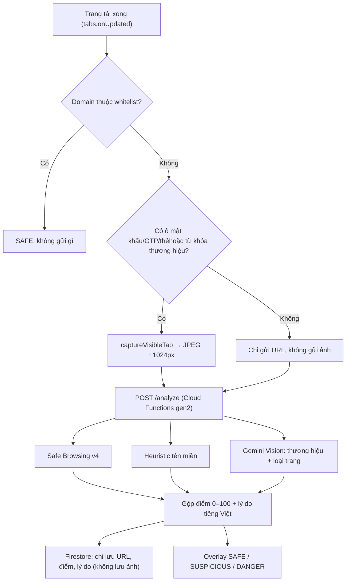

Mục lục

1. [Tóm tắt](#tomtat)
2. [Mốc thời gian](#moc)
3. [Vai trò](#vaitro)
4. [Kiến trúc](#kientruc)
5. [Chấm điểm rủi ro](#diem)
6. [API & schema](#api)
7. [Form đăng ký](#dangky)
8. [Chuẩn bị ≤30%](#chuanbi)
9. [Ngày thi](#ngaythi)
10. [Đo lường](#eval)
11. [Demo Day](#demo)
12. [Hỏi đáp](#qa)
13. [Rủi ro](#rui-ro)
14. [Antigravity](#antigravity)
15. [Thông số đã kiểm](#facts)
16. [Nguồn](#nguon)

GDG DevFest MienTrung 2026 · Mini Hackathon · Bảng An ninh mạng

# VietPhish Lens: kế hoạch triển khai cho đội 3 người

Tiện ích Chrome phát hiện trang giả mạo ngân hàng và cơ quan nhà nước Việt Nam, kể cả trang mới tạo vài giờ chưa có trong danh sách đen, bằng cách so "trang trông giống ai" với "tên miền thật là của ai".

Build: 07:30 đến 11:30 ngày 14/11/2026 (4 giờ) · Nộp bài: 11:30 đến 12:00, gồm GitHub và video demo 2 phút · Demo Day: 15:45, chỉ Top 8 · Làm trước tối đa 30% · Cập nhật: 11/11/2026

> **Cập nhật 11/11/2026 theo Sổ tay Thí sinh.** Đã sửa hai điểm. Một là lịch build co từ 4,5 giờ về 4 giờ (mục 02 và 09). Hai là video demo 2 phút trở thành sản phẩm chính, không còn là phương án dự phòng (mục 03, 08, 09, 11, 13). Còn hai điểm chờ mentor trả lời nên chưa sửa: backend dùng Cloud Functions hay Cloud Run, và Antigravity có bắt buộc không. Lịch chi tiết từng bước kèm prompt cho agent nằm ở `docs/NGAY-THI.md`.

> **Ghi chú về phần kỹ thuật.** Phần kỹ thuật thực tế theo `AGENTS.md`, `docs/API.md` và các file bước trong `.agent/workflows/`: JavaScript thuần, server Node chạy trên Cloud Run, không dùng Firestore, bộ đo 28 URL. Các mục 03, 04, 10, 12 và 14 dưới đây còn mô tả phương án cũ (Cloud Functions, TypeScript, Firestore, bộ 600 URL). Đội chờ mentor trả lời câu hỏi Cloud Functions hay Cloud Run rồi mới viết lại các mục đó. Khi hai nơi lệch nhau, làm theo `AGENTS.md` và file bước.

## 01Tóm tắt

**Nguyên tắc lõi:** trang *trông giống* thương hiệu X, *tên miền không thuộc* X, và *đòi* mật khẩu/OTP/số thẻ, thì gần như chắc chắn là lừa đảo. Không cần chờ ai báo cáo trang đó.

Pipeline 4 lớp: **whitelist** → **Google Safe Browsing** → **heuristic tên miền** (punycode, ký tự nhái, khoảng cách chữ, đuôi lạ, subdomain lừa) → **Gemini Vision** nhận diện thương hiệu từ ảnh chụp trang. Cuối cùng gộp thành điểm 0–100 và cảnh báo bằng tiếng Việt kèm lý do.

**SAFE \< 40**Huy hiệu xanh, không làm phiền

**SUSPICIOUS 40–69**Banner vàng ở đầu trang

**DANGER ≥ 70**Phủ đỏ toàn trang, nêu lý do, nút về trang chính thức

**Ba thứ phải có trên sân khấu**

(1) Trang giả trên tên miền mới bị chặn trong khi Safe Browsing vẫn báo "sạch". (2) Lý do cảnh báo bằng tiếng Việt dễ hiểu. (3) Bảng số đo so sánh 3 cấu hình: chỉ blacklist, chỉ heuristic, heuristic + Gemini.

**Không tuyên bố "đầu tiên"**

Hướng "logo giống thương hiệu nhưng domain khác" đã có trong nghiên cứu (Phishpedia, PhishIntention, VisualPhishNet). Chrome Enhanced Protection cũng dùng Gemini Nano. Điểm khác của mình là: thương hiệu Việt, dùng mô hình ngôn ngữ thị giác nên không cần huấn luyện, lý do giải thích bằng tiếng Việt, và có số đo trên dữ liệu Việt Nam.

## 02Mốc thời gian

| Khi nào | Việc | Đầu ra |
| --- | --- | --- |
| 10/10 → hạn đơn | Nộp form đăng ký (form mở 5/10; **kiểm tra hạn đóng đơn** trên form) | Đơn nộp xong, dùng khung trả lời ở mục 07 |
| +3–4 ngày | BTC gửi kết quả vòng đơn | Xác nhận được thi |
| Tuần 1–2 | Tài khoản, API key, whitelist, bộ dữ liệu | `official_domains.json`, `labels.csv` |
| Tuần 3 | Thiết kế UI, khung rỗng, trang demo giả, thử tay prompt | Mockup, scaffold chạy "hello", 2 trang demo |
| Tuần 4 (trước 14/11) | Tổng duyệt: laptop, file hosts, hotspot, quota; push `main` và gắn tag `pre-event` trước 07:30 ngày thi | Tag `pre-event`, `PREBUILT.md` |
| 07:30 đến 11:30 ngày 14/11 | Build theo lịch ở mục 09 | Tag `v1.0-demo`, video demo 2 phút |
| 11:30 đến 12:00 | Nộp code qua GitHub kèm video demo | Bài nộp đúng giờ |
| Sau 12:00 | Hội đồng mentor xem video, chọn Top 8 trong 31 đội | Kết quả Top 8 |
| 15:45 ngày 14/11 | Demo Day, chỉ khi vào Top 8: pitch và hỏi đáp | Theo kịch bản mục 11 |

## 03Vai trò

A

#### Extension / Frontend

Tiện ích Chrome MV3: bắt sự kiện tải trang, chụp màn hình, gọi API, overlay cảnh báo (Shadow DOM), popup. Điều khiển máy khi demo.

B

#### Backend / AI

Cloud Functions for Firebase: whitelist, Safe Browsing, heuristic tên miền, Gemini Vision, công thức điểm, Firestore. Dẫn phần giải pháp khi pitch.

C

#### Data / Eval / Pitch

Whitelist tên miền, bộ dữ liệu có nhãn, script đo, trang demo giả, slide. Chịu trách nhiệm chính về video demo 2 phút, là căn cứ để mentor chọn Top 8. Mở đầu và trình bày kết quả khi pitch.

## 04Kiến trúc

Ảnh chụp chỉ được gửi khi trang *không* thuộc whitelist và có dấu hiệu nhạy cảm (ô mật khẩu/OTP/số thẻ, hoặc tên miền có từ khóa thương hiệu). API key chỉ nằm ở server.



### Stack

| Phần | Chọn | Vì sao |
| --- | --- | --- |
| Extension | Chrome MV3, TypeScript + Vite (hoặc JS thuần) | Overlay trong Shadow DOM để CSS của trang không phá giao diện cảnh báo |
| Backend | Cloud Functions for Firebase gen2 (Node 20, TS) | Deploy 1 lệnh, đi chung project với Firestore; `defineSecret` giữ key; `minInstances: 1` ngày demo để tránh khởi động nguội |
| AI | `gemini-3.5-flash-lite`, dự phòng `gemini-3.8-flash` | Nhanh, rẻ, có vision và đầu ra JSON theo schema. Ghi model ID trong config vì Google đổi model rất nhanh |
| Blacklist | Safe Browsing Lookup API v4 | Miễn phí cho mục đích phi thương mại. Nhắc Web Risk khi nói về thương mại hóa |
| Thư viện | `tldts`, `punycode`, `fastest-levenshtein`, `confusables` | Tách eTLD+1, giải mã punycode, khoảng cách chữ, ký tự nhái |
| Lưu trữ | Firestore | Log phát hiện, báo cáo của người dùng, cache theo domain |

### Cấu trúc repo

```
vietphish-lens/
├─ extension/    manifest.json, src/background.ts, src/content.ts, src/overlay/, src/popup/
├─ server/       src/index.ts, src/pipeline/{whitelist,safebrowsing,heuristics,vision,fusion}.ts,
│                src/reasons.vi.ts, fusion.config.json, test/
├─ shared/       types.ts (hợp đồng API), official_domains.json
├─ eval/         dataset/{fake,real}/, labels.csv, phishvn_sample.csv, run_eval.ts, results/
├─ demo-sites/   vcb-fake/, vneid-fake/ (có watermark), serve.js, hosts.sample
└─ docs/         PREBUILT.md, process/ (artifact Antigravity, ảnh chụp), pitch/
```

## 05Chấm điểm rủi ro

Toàn bộ trọng số đặt trong `fusion.config.json`. Chỉ chỉnh trên tập dev, giữ tập test riêng.

1. **Whitelist** (gồm mọi tên miền đuôi `.gov.vn`, vì đăng ký bị kiểm soát): điểm 0, dừng.
2. **Safe Browsing trúng**: điểm 100.
3. **H, heuristic (tối đa 60):** punycode/ký tự nhái +25 · Levenshtein ≤ 2 so với domain chính thức +25 · có từ khóa thương hiệu trong domain lạ +20 · subdomain lừa kiểu `vietcombank.com.vn.abc.xyz` +25 · đuôi rủi ro (`.top .xyz .cc .icu .vip .shop`) +10 · domain đăng ký \< 30 ngày (RDAP, có timeout) +15 · form gửi sang host khác hoặc không HTTPS +10.
4. **V, vision (tối đa 60):** `mismatch` = Gemini nhận ra thương hiệu X và domain không thuộc X.\
   `V = 40·confidence·mismatch + 20·mismatch·[đòi mật khẩu/OTP/thẻ/CVV/PIN] + 5·[lời lẽ hối thúc]`
5. **Điểm = min(100, H + V).** Luật cứng cho trang zero-day: nếu mismatch, confidence ≥ 0,7 và đòi dữ liệu nhạy cảm thì điểm ≥ 85.

**Chống prompt injection**

Không đưa URL cho Gemini. Gemini chỉ trả lời "trang này trông giống ai và đòi gì". Việc so domain do code làm, nên trang lừa đảo không thể ghi chữ "trang này an toàn" để lừa mô hình.

### Mẫu lý do (reasons.vi.ts)

| Mã | Câu hiển thị |
| --- | --- |
| `BRAND_DOMAIN_MISMATCH` | Trang này trông giống **{brand}** nhưng địa chỉ **{domain}** không phải tên miền chính thức ({official}). |
| `ASKS_OTP` | Trang yêu cầu nhập mã OTP. Ngân hàng và cơ quan nhà nước không bao giờ hỏi OTP trên trang lạ. |
| `ASKS_PASSWORD` | Trang yêu cầu mật khẩu đăng nhập {brand} trên một tên miền lạ. |
| `ASKS_CARD` | Trang yêu cầu số thẻ hoặc CVV, dấu hiệu đánh cắp thông tin thẻ. |
| `LOOKALIKE_DOMAIN` | Tên miền {domain} gần giống {official} (chỉ khác {n} ký tự). |
| `HOMOGLYPH` | Tên miền dùng ký tự đánh lừa thị giác (punycode: {puny}). |
| `SUBDOMAIN_TRICK` | Tên miền thật là {registrable}; chữ "{brand}" phía trước chỉ là phần giả. |
| `SUSPICIOUS_TLD` | Đuôi .{tld} thường bị lợi dụng trong lừa đảo. |
| `NEW_DOMAIN` | Tên miền mới đăng ký {days} ngày trước. |
| `SAFE_BROWSING_HIT` | Google Safe Browsing đã xác định trang này là lừa đảo. |
| `URGENCY` | Trang dùng lời lẽ hối thúc (khóa tài khoản, cập nhật VNeID gấp…). |
| `VNEID_OFFLINE` | VNeID chỉ xác thực qua ứng dụng chính thức và vneid.gov.vn, không qua website lạ. |

## 06API và schema

Chốt `shared/types.ts` ngay 15 phút đầu ngày thi. Sau đó không ai đổi mà không báo nhóm.

### POST /analyze: request

```
{
  "url": "https://vietcombank-xacthuc.top/login",
  "title": "Vietcombank - Đăng nhập",
  "screenshot": "data:image/jpeg;base64,...",
  "signals": {
    "hasPasswordField": true,
    "hasOtpField": false,
    "formActionHost": "api.abc.xyz"
  },
  "mode": "full"
}
// mode: full | no_vision | blacklist_only (dùng cho eval)
```

### Response

```
{
  "verdict": "DANGER",
  "riskScore": 92,
  "brand": { "id": "vietcombank",
    "officialUrl": "https://vietcombank.com.vn" },
  "reasons": [{ "code": "BRAND_DOMAIN_MISMATCH",
    "text": "...", "weight": 40 }],
  "layers": { "whitelist": false,
    "safeBrowsing": "clean", "heuristics": 37 },
  "latencyMs": { "total": 2140, "vision": 1830 },
  "degraded": false
}
```

### Schema đầu ra Gemini

```
{
  "brand_detected": "vietcombank | vietinbank | bidv | agribank | techcombank | mbbank | acb | vpbank
                     | tpbank | sacombank | vneid | dichvucong | thue | bhxh | momo | zalopay | none",
  "confidence": 0.0,
  "page_type": "login | otp | payment | info | other",
  "asks_sensitive_data": ["password", "otp", "card_number", "cvv", "cccd", "pin"],
  "visual_evidence": ["logo Vietcombank góc trái", "ô nhập mã OTP"],
  "urgency_language": true
}
```

`brand_detected` là enum để mô hình không bịa ra thương hiệu ngoài danh sách. Server gọi song song Safe Browsing, heuristic và Gemini (`Promise.allSettled`), Gemini timeout 6 giây. Quá hạn thì trả kết quả từ heuristic kèm `degraded: true`.

**SDK đã đổi cách gọi**

Docs hiện tại của `@google/genai` (v2.28) dùng **Interactions API**: `ai.interactions.create(...)`, schema đặt trong `response_format`. Ngày 26/5/2026 có thay đổi phá vỡ tương thích (`outputs` → `steps`). B phải chạy thử đúng phiên bản SDK trong tuần chuẩn bị và ghi lại cách đọc response.

```
import { GoogleGenAI } from "@google/genai";
const ai = new GoogleGenAI({ apiKey: process.env.GEMINI_API_KEY });
const r = await ai.interactions.create({
  model: config.visionModel,               // "gemini-3.5-flash-lite"
  input: [
    { type: "text",  text: PROMPT_VI },
    { type: "image", data: jpegBase64, mime_type: "image/jpeg" }
  ],
  response_format: { type: "text", mime_type: "application/json", schema: BRAND_SCHEMA }
});
```

## 07Khung trả lời form đăng ký

- **Tên và tóm tắt:** VietPhish Lens: tiện ích Chrome dùng Gemini Vision "nhìn" trang web như người dùng, phát hiện trang giả mạo ngân hàng và cơ quan nhà nước Việt Nam ngay cả khi trang chưa có trong danh sách đen.
- **Vấn đề:** NCSC ghi nhận khoảng 125.600 địa chỉ web giả mạo. Đường dây nóng nhận hơn 21.800 phản ánh về VNeID giả chỉ trong 5 tuần. Trang lừa đảo sống vài giờ trên tên miền mới nên blacklist luôn chậm một bước.
- **Giải pháp:** 4 lớp kiểm tra (whitelist, Safe Browsing, heuristic tên miền, Gemini Vision) theo nguyên tắc "giống thương hiệu X + không phải tên miền của X + đòi OTP/mật khẩu". Cảnh báo bằng tiếng Việt có lý do.
- **Khác biệt:** ChongLuaDao dựa vào blacklist cộng đồng. Chrome Enhanced Protection không chuyên về thương hiệu Việt. Các nghiên cứu như Phishpedia cần huấn luyện và không có thương hiệu Việt.
- **Công nghệ Google:** Gemini API (vision, structured output), Safe Browsing API, Cloud Functions for Firebase, Firestore, Secret Manager, Antigravity.
- **Đo lường:** bộ dữ liệu có nhãn và so sánh 3 cấu hình theo precision, recall, tỷ lệ báo nhầm và độ trễ.
- **Đạo đức:** không truy cập hay phát tán trang lừa đảo thật. Trang demo do đội tự dựng, có watermark, chạy local.
- **Đội:** A Extension/UI · B Backend/AI · C Data/Eval/Pitch, ghi kèm kỹ năng thật của từng người.

## 08Chuẩn bị trước sự kiện (giữ ≤ 30%)

Chỉ làm dữ liệu, thiết kế, khung rỗng, tài khoản. Mọi thứ làm trước được ghi trong `docs/PREBUILT.md` và commit trên `main`. Commit cuối cùng trước giờ thi được gắn tag `pre-event` để BTC đối chiếu. Ô tích bên dưới chỉ lưu trên trình duyệt của bạn.

#### A · Extension

- [ ] Mockup overlay DANGER, banner SUSPICIOUS, popup, trạng thái "đang kiểm tra"
- [ ] Scaffold MV3 rỗng: manifest (`tabs, activeTab, storage, scripting` + host `<all_urls>`), service worker in "hello", Load unpacked chạy được
- [ ] Thử nhanh `captureVisibleTab` (tối đa 2 lần/giây; tự động cần `<all_urls>`), ghi kết luận rồi xóa code thử
- [ ] Thử file hosts trên laptop demo; tắt "Use secure DNS" trong Chrome nếu hosts bị bỏ qua
- [ ] Cài Antigravity, chạy thử Agent Manager 1 phiên

#### B · Backend / AI

- [ ] Tạo project Firebase (gói Blaze, đặt cảnh báo ngân sách 5 USD); bật Gemini API, Safe Browsing, Firestore, Secret Manager
- [ ] `firebase init functions` (TS), deploy `/health` rỗng
- [ ] Thử tay prompt và schema trong AI Studio với 5 ảnh; ghi kết quả vào docs
- [ ] Chạy thử SDK `@google/genai` bản hiện hành, ghi cách đọc response (Interactions API)
- [ ] Xem giới hạn free tier tại AI Studio; tạo key dự phòng ở project thứ 2

#### C · Data / Eval / Pitch

- [ ] `official_domains.json` khoảng 20 thương hiệu, **kiểm tay từng domain** (xem mục 15)
- [ ] Tải PhishVN, lọc nhóm bank/government/tax, lấy khoảng 300 URL giả + 300 URL thật (Tranco) cho đo heuristic
- [ ] 60 cặp ảnh + URL có nhãn (30 giả / 30 thật), chia dev 20 / test 40. Ảnh giả lấy từ bài cảnh báo trên báo và ngân hàng, **không mở trang lừa đảo thật**
- [ ] 2 trang demo HTML tĩnh (VCB đăng nhập, VNeID OTP), watermark "DEMO – KHÔNG PHẢI TRANG THẬT", `noindex`, form không gửi đi đâu
- [ ] Khung 7 slide, dàn ý pitch, kịch bản video demo 2 phút theo mục 11; tìm 1 vụ lừa đảo thật đã lên báo để mở đầu
- [ ] Cài và thử phần mềm quay màn hình có thu tiếng trên laptop demo, quay thử 30 giây rồi xuất file MP4

#### KHÔNG làm trước

- Logic heuristic, client Gemini, công thức điểm
- Overlay hoạt động thật, logic `background.ts`
- Script eval chạy được, dashboard

Tất cả viết trong ngày thi bằng Antigravity, lưu artifact làm bằng chứng cho tiêu chí "Quá trình thực hiện".

## 09Ngày thi, theo giờ

Theo Sổ tay Thí sinh, đội check-in và bắt đầu build lúc 07:30, nộp bài lúc 11:30. Tổng cộng 4 giờ. Nên có mặt từ 07:00 để check-in xong trước giờ build.

Mỗi ô trong bảng ghi mã bước, ví dụ B2. Mỗi mã ứng với một file prompt trong `.agent/workflows/`, cách dùng xem ở `docs/NGAY-THI.md`.

| Giờ | A · Extension | B · Backend / AI | C · Data / Eval / Video |
| --- | --- | --- | --- |
| 07:30–07:45 | Cả đội đọc lại hợp đồng API ở `docs/API.md`, `git pull --rebase` trên `main` (không tạo nhánh), mở workspace Antigravity, chụp màn hình lúc bắt đầu |  |  |
| 07:45–08:45 | 07:45–08:30 A1: `content.js` đọc tín hiệu và vẽ overlay, nghiệm thu bằng kết quả giả (`vpSend`), không cần server. Từ 08:30: A2 | 07:45–07:55 B1: whitelist và mẫu lý do. 07:55–08:20 B2: heuristic tên miền. 08:20–08:45 B3: gộp điểm. Song song từ khoảng 07:55: phiên agent thứ hai làm B4 (Gemini và Safe Browsing), B commit chậm nhất 08:45 | C1: bật trang demo, mở Chrome demo, nạp extension. 08:10–08:30 soạn lời cho video. 08:30–08:50 C2: `run_eval.js` chế độ cục bộ |
| 08:45–09:25 | 08:30–09:25 A2: viết `background.js` và tự kiểm | B5: `/analyze`, smoke 6/6 với server local, push khoảng 09:25 | 08:50–09:15 chuẩn bị bản nháp video |
| 09:15 · CP1 | B1 đến B4 đã push, B5 đang làm. A1 đã push, overlay hiện được bằng `vpSend`. A2 viết xong code. C1, C2 xong. C quay bản nháp video lần 1 (dùng overlay của A1 nếu chưa có server) để luôn có một bản nộp được. |  |  |
| 09:25–09:55 | 09:25–09:35 nghiệm thu A2: `git pull`, chạy server mock trên máy A. Từ 09:35: A3. Khoảng 09:50 đổi `API_BASE` sang URL Cloud Run, chạy lại 3 kịch bản | 09:25–09:50 B6 phần D1 đến D3: deploy với mock, smoke 6/6 với URL thật, báo URL | Chạy eval cục bộ, ghi số vào slide |
| 09:55 · MDP | Sản phẩm demo được tối thiểu: URL Cloud Run trả `/health`, extension trỏ tới, cả 3 kịch bản chạy đúng |  |  |
| 09:55–10:15 | A3: popup và chế độ `DEMO_OFFLINE` (tùy chọn) | 09:50–10:15 B6 phần D4 đến D6: bật Gemini thật, thử qua extension, `try-gemini.js` khi lỗi | Chạy eval qua API với 3 cấu hình, sắp sẵn cửa sổ để quay |
| 10:15 · CP2 | Đóng băng tính năng. Mọi người đã push lên `main`, chạy lại 3 kịch bản. Từ đây chỉ sửa lỗi, không thêm gì mới. |  |  |
| 10:15–10:45 | Sửa lỗi giao diện, câu chữ | Sửa lỗi, làm nóng server | Viết README, tập đọc lời video một lần có bấm giờ |
| 10:45–11:20 | Điều khiển máy khi quay | Đọc lời phần giải pháp | Quay video 2 phút, tối đa 3 lần quay, xuất MP4 |
| 11:20–11:30 | Tag `v1.0-demo`, push, mở GitHub kiểm tra đã lên đủ, xuất artifact Antigravity vào `docs/process/` |  |  |
| 11:30–12:00 | Nộp link GitHub và video. Một người nộp, một người kiểm tra lại link mở được ở cửa sổ ẩn danh. |  |  |

Cả đội làm chung trên `main`, mỗi người một thư mục (A `extension/`, B `server/`, C `eval/`, `scripts/`, `demo-sites/`, `docs/`). Trước mỗi lần push đều chạy `git pull --rebase`. Agent không tự commit, người làm bước commit sau khi kiểm lại.

Nếu B không theo nổi hai phiên agent cùng lúc thì C trông phiên B4 và duyệt lệnh nghiệm thu, B vẫn là người kiểm lại và commit.

### Luật cắt phạm vi

- Đến 09:55 chưa có MDP: bỏ A3, bỏ eval qua API, B và C cùng dồn vào ghép nối.
- Deploy (B6 phần D1 đến D3) tới 09:50 vẫn chưa xong: quay video với server chạy local, nói rõ điều đó trong video và README, rồi B deploy tiếp sau khi quay.
- Gemini thật vẫn lỗi hoặc chậm lúc 10:15: chạy với kết quả `degraded` từ heuristic, nói thẳng trong video.
- Đến 10:15 eval chưa chạy: chỉ lấy số của chế độ cục bộ, vẫn nêu cỡ mẫu.
- Thứ tự cắt: dashboard, RDAP, log Firestore, nút Báo cáo, popup, eval qua API, banner SUSPICIOUS.
- Không bao giờ cắt: overlay DANGER, lý do tiếng Việt, video 2 phút.
- 10:45 là giờ bắt đầu quay, không lùi. Lúc đó còn lỗi gì thì quay phần đang chạy được.

## 10Đo lường

Đây là phần ghi điểm "Công nghệ/Kỹ thuật". Hai tầng đo, cùng chạy bằng `eval/run_eval.ts`.

| Tầng | Dữ liệu | Đo gì |
| --- | --- | --- |
| Tên miền (quy mô lớn) | Khoảng 600 URL từ PhishVN (nhóm bank/gov/tax) + Tranco | Recall và tỷ lệ báo nhầm của riêng heuristic; không cần ảnh nên chạy nhanh |
| Thị giác (end-to-end) | 60 cặp ảnh + URL, test 40 mẫu | Precision, recall, tỷ lệ báo nhầm, độ trễ p50/p95 cho 3 cấu hình |

Ba cấu hình: `blacklist_only` (Safe Browsing lúc chạy) · `no_vision` (whitelist + Safe Browsing + heuristic) · `full` (thêm Gemini). Thông điệp mong đợi: blacklist bắt kém với trang mới; thêm Gemini thì recall tăng mà báo nhầm vẫn thấp. **Báo đúng số đo được, kể cả khi không đẹp**, và nêu hạn chế: mẫu nhỏ, một phần trang giả do đội tự dựng.

**Cẩn thận dữ liệu bị lẫn**

URL trong PhishVN có thể đã nằm trong Safe Browsing, nên cấu hình `blacklist_only` sẽ trông tốt trên tập đó. Phần "zero-day" chỉ chứng minh được bằng trang tự dựng trên tên miền mới chưa ai báo cáo.

## 11Video demo 2 phút và Demo Day

### Video demo 2 phút (sản phẩm chính)

Sau 12:00, hội đồng mentor xem video của 31 đội và chọn Top 8. Sổ tay ghi rõ video là căn cứ chính để chấm. Vì vậy video phải tự đứng được: người xem không có ai đứng cạnh giải thích.

Sổ tay yêu cầu ba điều: quay rõ các tính năng chính, giới thiệu ngắn gọn sản phẩm giải quyết vấn đề gì, và nộp đúng giờ.

| Thời gian | Hình trên màn hình | Lời đọc |
| --- | --- | --- |
| 0:00–0:15 | Tiêu đề bài báo về một vụ lừa đảo thật, kèm một số liệu NCSC | Vấn đề: trang giả sống vài giờ trên tên miền mới, blacklist luôn chậm một bước |
| 0:15–0:30 | Sơ đồ 4 lớp | Câu chốt: "Nhìn giống X, nhưng không phải nhà của X, lại đòi OTP." |
| 0:30–0:45 | Mở `vietcombank.com.vn`, huy hiệu xanh | Trang chính thức không bị làm phiền, không gửi ảnh đi đâu |
| 0:45–1:15 | Mở `vietcombank-xacthuc.top`, màn hình phủ đỏ, rê chuột qua từng lý do, bấm "Về trang chính thức" | Đọc 3 lý do bằng tiếng Việt. Nói rõ Safe Browsing chưa biết trang này |
| 1:15–1:35 | Mở `vneid-capnhat.cc`, phủ đỏ với lý do OTP và VNeID | VNeID chỉ xác thực qua ứng dụng chính thức |
| 1:35–1:50 | Console Cloud Run đang chạy service, log một request có gọi Gemini | Công nghệ Google: Gemini API, Cloud Run, Safe Browsing |
| 1:50–2:00 | Bảng số đo và tên đội | Kết quả đo được, cỡ mẫu, hướng phát triển trong một câu |

Lưu ý khi quay:

- Quay ở độ phân giải 1080p, phóng to trình duyệt 125% để chữ trong cảnh báo đọc được.
- Tắt thông báo hệ thống, đóng các tab không liên quan.
- Nếu dùng server local hoặc kết quả đã cache thì nói thẳng trong video.
- Thu tiếng xong nghe lại 10 giây đầu trước khi quay tiếp, để chắc micro có hoạt động.
- Xuất MP4, kiểm tra thời lượng không quá 2 phút, mở thử file trước khi nộp.

### Demo Day (chỉ khi vào Top 8)

Demo Day bắt đầu lúc 15:45. Giả định 4 phút pitch + 4 phút hỏi đáp (giống năm 2025). Kiểm tra lại khi BTC công bố.

| Thời gian | Ai | Nội dung |
| --- | --- | --- |
| 0:00–0:30 | C | Mở đầu bằng một vụ lừa đảo **thật đã lên báo** (giả VNeID hoặc ngân hàng) và một số liệu NCSC. Không bịa chuyện người thân. |
| 0:30–1:00 | C | Vấn đề: blacklist chậm một bước; người dùng không đọc URL. |
| 1:00–1:30 | B | Sơ đồ 4 lớp. Câu chốt: "Nhìn giống X, nhưng không phải nhà của X, lại đòi OTP." |
| 1:30–3:00 | A thao tác, B dẫn | 1. `vietcombank.com.vn` → huy hiệu xanh, không gửi ảnh. 2. `vietcombank-xacthuc.top` (Safe Browsing báo sạch) → phủ đỏ, đọc 3 lý do, bấm "Về trang chính thức". 3. `vneid-capnhat.cc` đòi OTP → cảnh báo `ASKS_OTP` + `VNEID_OFFLINE`. |
| 3:00–3:40 | C | Bảng 3 cấu hình, độ trễ p50, chi phí ước tính mỗi 1.000 lượt. |
| 3:40–4:00 | B | Quá trình (artifact Antigravity + git log) và hướng phát triển: chạy trên máy bằng Gemini Nano, API cho ngân hàng, chia sẻ dữ liệu với NCSC. |

**Dự phòng**

Trang demo chạy local qua file hosts, không phụ thuộc WiFi và không bao giờ lên Internet. Hotspot 4G bật sẵn. Extension có cờ `DEMO_OFFLINE` đọc kết quả thật đã chạy trước. Video demo đã nộp buổi sáng mở sẵn ở tab 2. Nếu phải chuyển sang chế độ dự phòng, nói rõ với giám khảo.

## 12Hỏi đáp dự kiến

Chụp màn hình có lộ dữ liệu người dùng không?

Trang thuộc whitelist không bao giờ bị chụp. Chỉ chụp khi trang lạ và có ô nhập nhạy cảm. Ảnh được nén, xử lý xong là bỏ; Firestore chỉ lưu URL, điểm và lý do. Hướng tiếp: che vùng nhập liệu trước khi gửi, hoặc chạy trên máy bằng Gemini Nano.

Báo nhầm trang thật thì sao?

Phải đủ cả 3 điều kiện mới ra DANGER. Whitelist luôn ưu tiên. Trang chỉ nhắc tên thương hiệu (bài báo) không đòi OTP nên không bị chặn. Tỷ lệ báo nhầm đo được là X% trên các trang thật. Có nút báo nhầm.

Độ trễ và chi phí?

Nhánh whitelist dưới 50 ms. Nhánh Gemini p50 khoảng X giây, chạy song song và có cache. Chỉ một phần nhỏ lượt duyệt cần gọi Gemini. Flash-Lite giá $0,30 / $2,50 mỗi 1 triệu token vào/ra; C tính chi phí mỗi 1.000 lượt từ số token đo được.

Sao không dùng luôn Safe Browsing của Chrome?

Có dùng, đó là lớp 2. Nhưng danh sách luôn chậm với tên miền mới vài giờ. Enhanced Protection không chuyên về VNeID hay ngân hàng Việt và không giải thích bằng tiếng Việt.

Mở rộng thế nào?

Cloud Functions gen2 tự co giãn. Cache theo domain dùng chung: một người phát hiện thì mọi người được bảo vệ. Khi thương mại hóa thì chuyển sang Web Risk API.

Cập nhật whitelist ra sao?

File JSON có phiên bản, extension tải mỗi ngày. Nguồn: danh sách tổ chức tín dụng của NHNN và hậu tố `.gov.vn`. Báo cáo người dùng được duyệt rồi mới thêm.

Kẻ gian đổi logo để né?

Gemini nhìn cả bố cục, màu và chữ, không chỉ logo. Đổi đến mức không còn giống thương hiệu thì nạn nhân cũng khó bị lừa. Heuristic tên miền vẫn là lớp chặn độc lập.

Có tự chấm cho mình điểm cao không?

Tách dev và test, khóa trọng số trước khi chạy test. Công bố cỡ mẫu và hạn chế.

## 13Rủi ro

| Rủi ro | Giảm thiểu |
| --- | --- |
| WiFi hỏng khi demo | Trang demo local + hosts; hotspot 4G; `DEMO_OFFLINE`; video demo đã nộp |
| Không kịp quay video, hoặc video hỏng tiếng | Quay bản nháp lần 1 ngay tại CP1 lúc 09:15; giờ quay chính 10:45 không lùi; thử phần mềm quay và micro từ trước ngày thi; mở lại file MP4 trước khi nộp |
| Hết 4 giờ mà chưa xong | Lịch mục 09 có mốc MDP lúc 09:55 và đóng băng tính năng lúc 10:15; luật cắt phạm vi ghi sẵn thứ tự bỏ |
| Gemini hết quota, trả 429 hoặc chậm | Cache theo hash URL + ảnh; timeout 6 giây rồi trả kết quả heuristic; key dự phòng; làm nóng trước giờ demo |
| Model bị đổi hoặc ngừng (Google vừa deprecate 3.5/3.7 Flash ngày 8/10) | Model ID trong config; kiểm tra lại danh sách model tuần trước ngày thi |
| `captureVisibleTab` lỗi (thiếu quyền, giới hạn 2 lần/giây, trang `chrome://`) | Host permission `<all_urls>`; chỉ chụp tab đang hiển thị đã tải xong; debounce; lỗi thì vẫn gửi URL không kèm ảnh |
| Antigravity hết lượt hoặc trục trặc | Đăng nhập tài khoản Google AI Pro nếu có (gói miễn phí giới hạn theo tuần); dự phòng VS Code + Gemini CLI; commit thường xuyên |
| Trang demo bị Safe Browsing hoặc Firebase gắn cờ | Bản chính chạy local; watermark + `noindex`; không có backend nhận form |
| Bị cho là làm trước quá 30% | `PREBUILT.md` + tag `pre-event`; mọi logic có commit trong ngày thi |
| Báo nhầm trên trang thật lúc demo | Whitelist đứng đầu; tập dev có trang thật "khó"; khóa ngưỡng ở CP2 |
| Lộ API key | Key chỉ trong Secret Manager, không bao giờ trong extension; `.env` trong `.gitignore` |

## 14Dùng Antigravity cho đội 3 người

- **Mỗi người một agent hoặc worktree** (Antigravity 2.0 có chế độ worktree), giới hạn trong thư mục của mình: A `extension/`, B `server/`, C `eval/` và `demo-sites/`. Đặt rule: "không sửa `shared/types.ts` khi chưa báo nhóm".
- **Planning mode cho phần lõi** (fusion, vision, overlay): agent lập Implementation Plan và Task List, người phụ trách duyệt rồi mới chạy. Lưu plan vào `docs/process/`.
- **Chạy song song:** B cho một agent viết heuristic + unit test, một agent làm vision. C cho agent sinh test case tên miền từ `official_domains.json`.
- **Browser agent** để mở trang demo, chụp ảnh, kiểm tra backend. Chưa xác nhận được nó có nạp extension unpacked hay không, nên A tự test extension bằng `chrome://extensions` → Load unpacked.
- **Commit 20–30 phút một lần**, ghi rõ, ví dụ `feat(server): fusion rule [plan-03]`. Slide "Quá trình" gồm timeline commit, 3 ảnh artifact, và 1 ví dụ người sửa lại plan của agent.
- **Người review, agent viết:** không merge code của agent khi chưa chạy lại 3 kịch bản. B đọc kỹ phần so khớp domain (eTLD+1 bằng `tldts`).

## 15Thông số đã kiểm (10/10/2026)

Đã kiểm có nguồn chính thức. Cần kiểm lại chưa chắc hoặc hay thay đổi.

| Mục | Giá trị |  |
| --- | --- | --- |
| Model stable | `gemini-3.8-flash`, `gemini-3.6-flash`, `gemini-3.5-flash-lite`, `gemini-3.1-flash-lite` | Đã kiểm |
| Giá | 3.5 Flash-Lite $0,30 / $2,50; 3.8 Flash $0,75 / $3,75 (mỗi 1 triệu token vào/ra); cả 4 model có free tier | Đã kiểm |
| Giới hạn free tier | Không còn bảng công khai, xem tại AI Studio | Cần kiểm lại |
| Độ trễ Gemini | Ước 1–3 giây mỗi ảnh với Flash-Lite, phải tự đo | Cần kiểm lại |
| `captureVisibleTab` | Cần `activeTab` (sau thao tác người dùng) hoặc `<all_urls>` (tự động); tối đa 2 lần/giây; chỉ tab đang hiển thị | Đã kiểm |
| Safe Browsing v4 | Miễn phí, chỉ phi thương mại. Web Risk: cần billing, 100.000 lượt lookup/tháng miễn phí | Đã kiểm |
| API ChongLuaDao | Đã ngừng; danh sách chặn ngừng cập nhật từ 3/5/2025 | Đã kiểm |
| Bộ dữ liệu PhishVN | 53.116 URL (NCSC, ChongLuaDao, OpenPhish, Tranco), CC BY 4.0, bản 18/8/2026 | Đã kiểm |
| Chính phủ | vneid.gov.vn · dichvucong.gov.vn · gdt.gov.vn · thuedientu.gdt.gov.vn · canhantmdt.gdt.gov.vn · baohiemxahoi.gov.vn · vss.gov.vn | Đã kiểm |
| Ngân hàng | vietcombank.com.vn · vietinbank.vn · bidv.com.vn · agribank.com.vn · techcombank.com (+ .com.vn) · mbbank.com.vn · acb.com.vn · vpbank.com.vn · tpb.vn · sacombank.com.vn · hdbank.com.vn · vib.com.vn · msb.com.vn · ocb.com.vn · shb.com.vn | Đã kiểm |
| Ví điện tử | momo.vn · zalopay.vn · vnpay.vn | Đã kiểm |
| Subdomain ngân hàng số | Ví dụ vcbdigibank.vietcombank.com.vn; so theo eTLD+1 là đủ, nhưng cần liệt kê thêm domain riêng của app ngân hàng nếu có | Cần kiểm lại |
| Thư viện npm | punycode 2.3.1 · tldts 7.4.18 · fastest-levenshtein 1.0.16 · confusables 1.1.1 | Đã kiểm |
| Antigravity nạp extension | Không có tài liệu xác nhận browser agent nạp được extension unpacked | Cần kiểm lại |

## 16Nguồn

- [Form đăng ký Mini Hackathon DevFest MienTrung 2026](https://docs.google.com/forms/d/e/1FAIpQLScyfavKQyQfIpnvEY30ok01wVSMr2g_Qo_gV3fZFrg2jW7XJw/viewform)
- [VnEconomy: chung kết DevFest MienTrung 2025](https://vneconomy.vn/8-du-an-cong-nghe-ung-dung-ai-xuat-sac-bat-dau-so-tai-tai-chung-ket-gdg-devfest-mientrung-2025.htm)
- [VnEconomy: gần 125.500 website giả mạo](https://vneconomy.vn/phat-hien-gan-125-500-website-gia-mao-lien-quan-den-lua-dao.htm)
- [LSVN: lừa đảo cài VNeID giả](https://lsvn.vn/canh-giac-lua-dao-mao-danh-cong-an-yeu-cau-tai-cai-ung-dung-vneid-gia-mao-a150518.html)
- [Gemini API: danh sách model](https://ai.google.dev/gemini-api/docs/models) · [changelog](https://ai.google.dev/gemini-api/docs/changelog) · [bảng giá](https://ai.google.dev/gemini-api/docs/pricing) · [structured output](https://ai.google.dev/gemini-api/docs/structured-output) · [image understanding](https://ai.google.dev/gemini-api/docs/image-understanding)
- [SDK @google/genai](https://github.com/googleapis/js-genai)
- [Chrome tabs API (captureVisibleTab)](https://developer.chrome.com/docs/extensions/reference/api/tabs)
- [Safe Browsing v4: giới hạn sử dụng](https://developers.google.com/safe-browsing/v4/usage-limits) · [Web Risk: bảng giá](https://cloud.google.com/web-risk/pricing)
- [Bộ dữ liệu PhishVN (Mendeley)](https://data.mendeley.com/datasets/b97hxbxtpd) · [vn-badsite-filter (ngừng cập nhật)](https://git.nixnet.services/curben/vn-badsite-filter)
- [Extension ChongLuaDao](https://chromeboard.com/extension/chongluadao-mdcemplfpeifcogglenloohjghjbigni) · [Chrome dùng Gemini Nano chống lừa đảo](https://www.bleepingcomputer.com/news/security/google-chrome-to-use-on-device-ai-to-detect-tech-support-scams/)
- [Phishpedia (USENIX Security 2021)](https://www.usenix.org/conference/usenixsecurity21/presentation/lin) · [PhishIntention (2022)](https://usenix.org/conference/usenixsecurity22/presentation/liu-ruofan) · [VisualPhishNet](https://arxiv.org/pdf/1909.00300)
- [Antigravity: getting started](https://antigravity.google/docs/getting-started) · [Thoughtworks Radar](https://www.thoughtworks.com/radar/tools/google-antigravity)

Tổng hợp từ nghiên cứu của nhiều agent và đã đối chiếu thông số kỹ thuật ngày 10/10/2026. Model Gemini và hạn mức thay đổi nhanh: kiểm tra lại mục 15 trong tuần trước ngày thi.